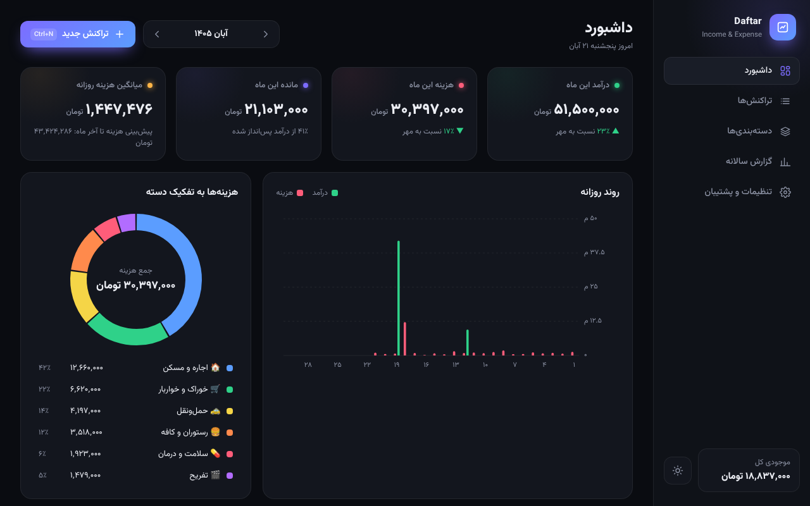

<div align="center">


# Daftar

[فارسی](README.md) | **English**

**A simple income & expense notebook for Windows**

See how much money came in and how much went out. That's it.



[Download the installer](https://github.com/sarenkaido/drafter/releases/latest/download/Daftar-Setup-1.0.0.exe) &nbsp;·&nbsp;
[Download the portable version](https://github.com/sarenkaido/drafter/releases/latest/download/Daftar-Portable-1.0.0.exe)

</div>

> The app's interface is in Persian (Farsi) and uses the Persian (Jalali) calendar.

---

## Use it in 3 steps

### 1. Download
Click **"Download the installer"** at the top of this page.
It's only about 1.5 MB.

### 2. Install
**Double-click** the downloaded file, then click **Next → Next → Finish**.
A **Daftar** icon appears on your desktop.

> If Windows shows a blue screen saying "Windows protected your PC",
> click **More info**, then **Run anyway**. Windows shows this for most new apps.

### 3. Write it down
- Click the purple **"+ تراکنش جدید"** (New transaction) button.
- Pick **هزینه** (expense, red) or **درآمد** (income, green).
- Type the **amount**.
- Pick a **category**, for example Groceries.
- Click **ذخیره** (Save). Done!

---

## What it does

- Log daily income and expenses with a **Persian (Jalali) calendar**
- **Categories** with your own icons and colors
- Daily and monthly **charts**, plus a yearly report
- **Search** and filter your transactions
- **Export** to Excel (CSV) or a full backup file
- **Import** from an Excel (CSV) or backup file
- **Automatic daily backup** (the last 14 days are kept)
- **Dark** and **light** themes
- Fully **offline**: nothing is ever sent to the internet

## Keyboard shortcuts

| Key | Action |
|---|---|
| `Ctrl` + `N` | New transaction |
| `Enter` | Save |
| `Esc` | Close the window |
| `Ctrl` + `F` | Search (on the transactions page) |

## FAQ

**Where is my data saved?**
Only on your own computer. In the app, go to **Settings → Open folder** (تنظیمات ← باز کردن پوشه).

**How do I move my data to another laptop?**
On the old laptop, go to **Settings → Full backup export** (تنظیمات ← خروجی پشتیبان کامل).
Copy the file to the new laptop and use **Settings → Import from file** (تنظیمات ← ورود از فایل).

**I see "Could not find the WebView2 Runtime".**
Open [this link](https://go.microsoft.com/fwlink/p/?LinkId=2124703), install the small app it downloads, then open Daftar again.
(It is usually already installed on Windows 10 and 11.)

**Will uninstalling delete my data?**
No. Your data stays, so it comes back if you install again.

**What should a CSV file for import look like?**
These columns are enough, in any order. Persian or English headers both work:

| date | type | category | amount | note |
|---|---|---|---|---|
| 1405/08/10 | expense | Groceries | 250000 | Fruit |
| 1405/08/11 | income | Salary | 40000000 | |

Dates can be Persian (`1405/08/10`) or Gregorian (`2026-11-01`).

---

## For developers

Built with [Tauri 2](https://tauri.app) (Rust) and plain HTML/CSS/JS. There's no framework and no build step for the UI.

```
ui/          the app UI (HTML, CSS, JS, font)
src-tauri/   Rust backend: saves data, file dialogs, backups
installer/   NSIS scripts for the setup and portable .exe
scripts/     cargo config for cross-compiling from Linux
```

Quick start on Windows (needs [Node.js](https://nodejs.org) and [Rust](https://rustup.rs)):

```bash
npm install
npm run dev      # run with live reload
npm run build    # build src-tauri/target/release/Daftar.exe
```

Publishing a GitHub release builds both installers automatically and attaches them to the release.
Building the installers yourself and cross-compiling from Linux are covered in [docs/BUILD.md](docs/BUILD.md).

## Credits

- Font: [Vazirmatn](https://github.com/rastikerdar/vazirmatn), SIL Open Font License ([ui/fonts/OFL.txt](ui/fonts/OFL.txt))
- Jalali calendar math adapted from [jalaali-js](https://github.com/jalaali/jalaali-js) (MIT)

## License

[MIT](LICENSE)
