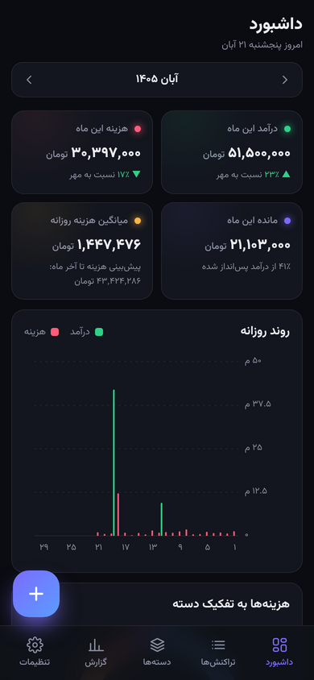

# Daftar

**فارسی** | [English](README.en.md)

**دفتر ساده‌ی دخل و خرج برای ویندوز، اندروید و لینوکس**

ببین چقدر پول اومد، چقدر رفت. همین.

&nbsp;&nbsp;

---

## دانلود

| دستگاه | فایل | حجم |
|---|---|---|
| ویندوز | [نسخه‌ی نصبی](https://github.com/sarenkaido/drafter/releases/latest/download/Daftar-Windows-Setup.exe) | حدود ۱٫۵ مگ |
| ویندوز (بدون نصب) | [نسخه‌ی پرتابل](https://github.com/sarenkaido/drafter/releases/latest/download/Daftar-Windows-Portable.exe) | حدود ۱٫۵ مگ |
| اندروید | [فایل APK](https://github.com/sarenkaido/drafter/releases/latest/download/Daftar-Android.apk) | حدود ۱۰ مگ |
| لینوکس (همه‌ی توزیع‌ها) | [AppImage](https://github.com/sarenkaido/drafter/releases/latest/download/Daftar-Linux-x86_64.AppImage) | حدود ۸۰ مگ |
| لینوکس (اوبونتو / دبیان) | [فایل deb](https://github.com/sarenkaido/drafter/releases/latest/download/Daftar-Linux-amd64.deb) | حدود ۲ مگ |

همه‌ی نسخه‌ها: [صفحه‌ی Releases](https://github.com/sarenkaido/drafter/releases)

## استفاده در ۳ قدم

### ۱. دانلود کن
از جدول بالا، فایل دستگاهت را بزن.

### ۲. نصب کن

**ویندوز:**
فایل را **دو بار کلیک** کن، بعد **بعدی ← بعدی ← پایان** را بزن.
یک آیکون **Daftar** روی دسکتاپ ظاهر می‌شود.

> اگر ویندوز یک صفحه‌ی آبی نشان داد که می‌گوید «Windows protected your PC»،
> روی **More info** و بعد **Run anyway** بزن.

**اندروید:**
فایل APK را باز کن و **نصب** را بزن.

> اگر گوشی گفت نصب از این منبع مجاز نیست، روی **تنظیمات** بزن و
> **اجازه از این منبع** را روشن کن، بعد برگرد و **نصب** را بزن.
> اگر Play Protect هشدار داد، **جزئیات بیشتر ← در هر صورت نصب شود** را بزن.

**لینوکس:**
- **AppImage:** روی فایل راست‌کلیک کن، در **Properties** گزینه‌ی **Allow executing as program** را روشن کن و بعد دو بار کلیک کن.
- **deb:** فایل را دو بار کلیک کن تا با نرم‌افزار نصب باز شود، یا در ترمینال بنویس:
  `sudo apt install ./Daftar-Linux-amd64.deb`

### ۳. بنویس
- دکمه‌ی بنفش **«+»** را بزن (در کامپیوتر: **«+ تراکنش جدید»**).
- **هزینه** (قرمز) یا **درآمد** (سبز) را انتخاب کن.
- **مبلغ** را بنویس.
- **دسته** را انتخاب کن، مثلاً خوراک.
- **ذخیره** را بزن. تمام!

---

## چه کارهایی می‌کند؟

- ثبت دخل و خرج روزانه، با تقویم **شمسی**
- **دسته‌بندی** با آیکون و رنگ دلخواه
- **نمودار** روزانه و ماهانه و گزارش سالانه
- **جستجو** و فیلتر تراکنش‌ها
- **خروجی** اکسل (CSV) و فایل پشتیبان
- **ورود** اطلاعات از فایل اکسل یا پشتیبان
- **پشتیبان خودکار** هر روز (۱۴ روز آخر نگه داشته می‌شود)
- تم **تیره** و **روشن**
- کاملاً **آفلاین**: هیچ اطلاعاتی به اینترنت فرستاده نمی‌شود

## میان‌برها (کامپیوتر)

| کلید | کار |
|---|---|
| `Ctrl` + `N` | تراکنش جدید |
| `Enter` | ذخیره |
| `Esc` | بستن پنجره |
| `Ctrl` + `F` | جستجو (در صفحه‌ی تراکنش‌ها) |

## سؤال‌های رایج

**اطلاعاتم کجا ذخیره می‌شود؟**
فقط روی دستگاه خودت. در کامپیوتر، از **تنظیمات ← باز کردن پوشه** می‌توانی پوشه‌اش را ببینی.

**می‌خواهم اطلاعاتم را به دستگاه دیگری ببرم (مثلاً از لپ‌تاپ به گوشی). چه کنم؟**
در دستگاه قدیمی برو به **تنظیمات ← خروجی پشتیبان کامل**.
فایل را به دستگاه جدید بفرست و آنجا **تنظیمات ← ورود از فایل** را بزن.
این کار بین ویندوز، اندروید و لینوکس هم جواب می‌دهد.

**نسخه‌ی جدید آمده. اطلاعاتم پاک می‌شود؟**
نه. نسخه‌ی جدید را روی همان قبلی نصب کن. اطلاعات سر جایش می‌ماند.

**اگر برنامه را حذف کنم، اطلاعاتم پاک می‌شود؟**
در ویندوز و لینوکس نه. در اندروید، حذف برنامه اطلاعات را هم پاک می‌کند، پس قبلش **خروجی پشتیبان کامل** بگیر.

**در ویندوز پیام «WebView2 پیدا نشد» آمد.**
[این لینک](https://go.microsoft.com/fwlink/p/?LinkId=2124703) را باز کن، برنامه‌ی کوچکی که دانلود می‌شود را نصب کن و دوباره Daftar را باز کن.
(در ویندوز ۱۰ و ۱۱ معمولاً از قبل نصب است.)

**فایل اکسل برای ورود چه شکلی باشد؟**
این ستون‌ها کافی است (ترتیب مهم نیست):

| تاریخ | نوع | دسته | مبلغ | توضیحات |
|---|---|---|---|---|
| 1405/08/10 | هزینه | خوراک | 250000 | خرید میوه |
| 1405/08/11 | درآمد | حقوق | 40000000 | |

## برای برنامه‌نویس‌ها

برنامه با [Tauri 2](https://tauri.app) (Rust) و HTML/CSS/JS ساده ساخته شده است. راهنمای اجرا و ساخت در [نسخه‌ی انگلیسی](README.en.md#for-developers) و [docs/BUILD.md](docs/BUILD.md) است.

## منابع

- فونت: [Vazirmatn](https://github.com/rastikerdar/vazirmatn)، با مجوز SIL Open Font License ([ui/fonts/OFL.txt](ui/fonts/OFL.txt))
- محاسبات تقویم شمسی برگرفته از [jalaali-js](https://github.com/jalaali/jalaali-js) (MIT)

## مجوز

[MIT](LICENSE)

